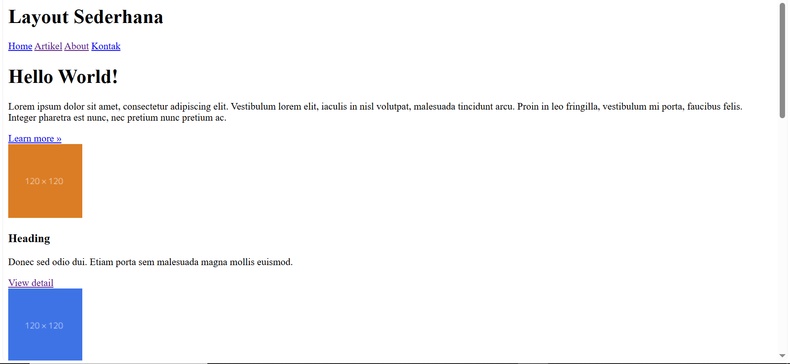
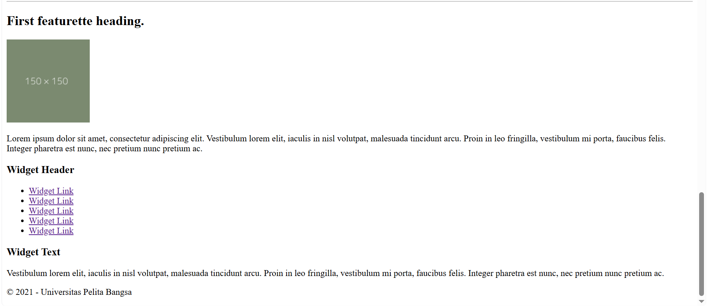
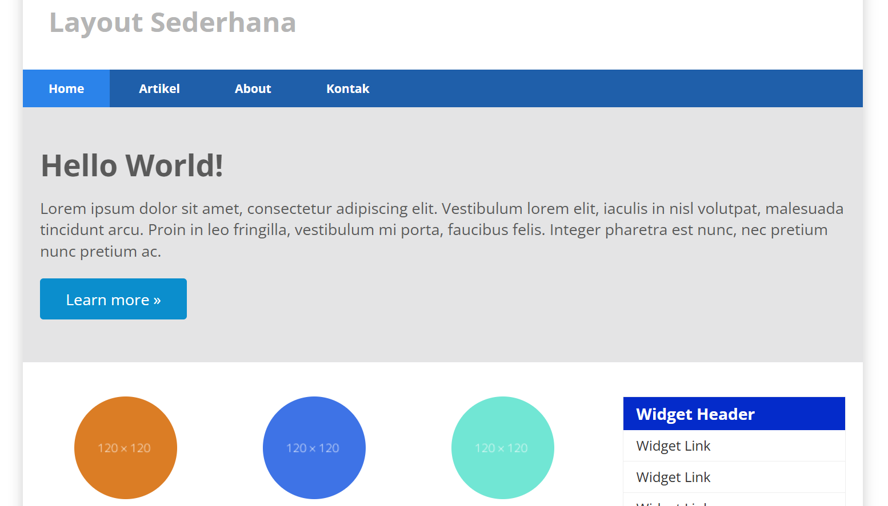
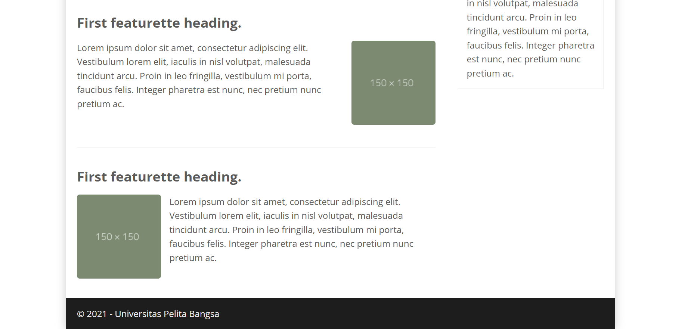
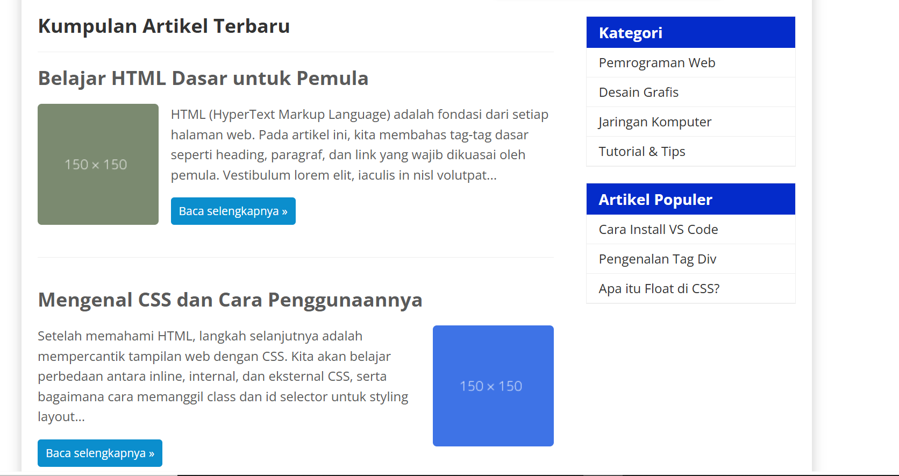
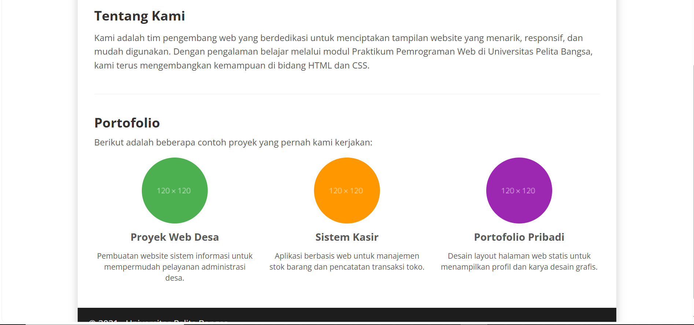
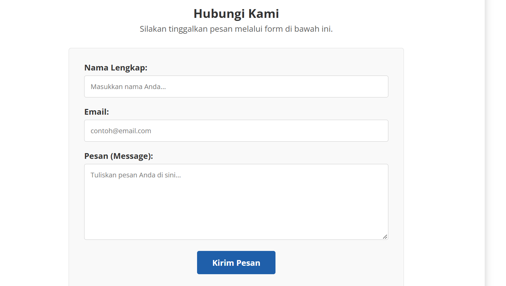

# Praktikum 4: Membuat Layout Web Sederhana

Repositori ini (`Lab4Web`) berisi hasil pengerjaan **Modul 4: Membuat Layout Web Sederhana** pada mata kuliah Pemrograman Web. Proyek ini bertujuan untuk mempraktikkan penggunaan *Semantic Elements* HTML5 dan teknik *layouting* menggunakan properti `float` pada CSS.

## 📌 Deskripsi Proyek
Proyek ini berupa website sederhana yang terdiri dari empat halaman yang saling terhubung melalui menu navigasi. Layout halaman dibangun menggunakan elemen semantik seperti `<header>`, `<nav>`, `<section>`, `<article>`, `<aside>`, dan `<footer>`, serta dihias menggunakan CSS eksternal.

## 📂 Struktur File
Proyek ini memiliki struktur file sebagai berikut:
1. `style.css` - Berisi *reset CSS*, pengaturan *font*, tata letak (*float*, *box-sizing*), dan pewarnaan untuk seluruh halaman web.
2. `home.html` - Halaman utama yang berisi panel pahlawan (*hero panel*), konten artikel utama berkolom (*row & box*), dan *sidebar* (layot multi-kolom).
3. `artikel.html` - Halaman daftar artikel dengan susunan *main content* di sebelah kiri dan *sidebar* (widget) di sebelah kanan.
4. `about.html` - Halaman "Tentang Kami" dan "Portofolio" yang menggunakan desain *single layout* (lebar penuh tanpa sidebar) dengan *grid* gambar 3 kolom.
5. `kontak.html` - Halaman untuk menghubungi pengelola web yang berisi *form* masukan (Nama, Email, dan Pesan) dengan menggunakan *single layout*.

## 💡 Penjelasan Teknik Layout
*   **Semantic HTML**: Menghindari penggunaan `
` yang berlebihan dengan menggantinya menjadi tag yang memiliki makna khusus (misal: `<article>` untuk isi berita).
*   **Float & Clearfix**: Mengatur agar *Main Content* dan *Sidebar* bisa bersebelahan menggunakan `float: left`. Serta menggunakan trik *clearfix* (pseudo-element `:after` dan `:before`) agar kontainer induk tidak berantakan setelah elemen di dalamnya di-*float*.
*   **Box Sizing**: Penggunaan `box-sizing: border-box` agar ukuran *padding* dan *border* tidak menambah lebar elemen secara keseluruhan.
*   **Single Layout vs Multi-column Layout**: Modifikasi CSS untuk menghilangkan `float` pada halaman *About* dan *Kontak* agar konten memakan ruang kontainer 100% penuh.

## 📸 Screenshot Hasil Praktikum

*(Silakan simpan screenshot Anda di dalam folder proyek, lalu ubah nama file di bawah ini sesuai dengan nama screenshot Anda, misalnya `home_ss.png`)*

### 1. Halaman Home sebelum berisi CSS

### 2. Halaman Home sebelum berisi CSS

### 3. Halaman Artikel

### 4. Halaman About

### 5. Halaman Kontak
